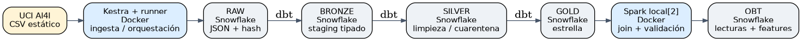

# PSet 2 — Pipeline de mantenimiento: AI4I

**Autor:** Felipe Ron Andrade. **Documento:** [PSet2_memo_Ron_Andrade.pdf](docs/PSet2_memo_Ron_Andrade.pdf).

Pipeline batch para preparar datos de **detección de falla en la lectura actual**. AI4I es sintético y no permite estimar vida útil restante ni predecir el siguiente ciclo.

`UCI → Kestra → Snowflake RAW → dbt BRONZE → SILVER → GOLD → Spark → Snowflake OBT`



La validación local aprobó 6 modelos dbt, 14 tests de datos, 4 pruebas de código y una OBT de 10.000 filas. Kestra ejecutó una prueba local con retry. **La ejecución completa en Snowflake está pendiente** de configurar una cuenta propia y comprobar sus resultados. Ver [evidencia y limitaciones](docs/validation.md) y [cumplimiento](docs/cumplimiento.md).

## Estructura

```text
Pset-02/
├── docker-compose.yml           # Kestra, Postgres de metadatos, runner y Spark
├── Dockerfile                   # Imagen compartida de ingesta, dbt y Spark
├── .env.example                 # Plantilla de configuración, sin credenciales
├── .gitignore / .dockerignore   # Exclusiones de secretos y artefactos
├── requirements.txt            # Dependencias directas
├── requirements.lock           # Dependencias fijadas para construir la imagen
├── kestra/
│   ├── flows/pipeline.yml       # Pipeline completo y trigger semanal
│   ├── flows/local_validation.yml # Prueba local de retry
│   └── scripts/                # Extractor AI4I y conexión Snowflake
├── dbt/                        # Bronze, Silver, Gold, macros y tests
├── spark/build_obt.py           # OBT y controles de joins/persistencia
├── scripts/                    # Utilidades de despliegue, validación y sensibilidad
├── tests/                      # Contratos del extractor y joins Spark
└── docs/                       # Memo, diagramas, setup SQL y evidencia
```

`secrets/`, `.env` y `artifacts/` se crean en cada instalación y no se versionan. El [modelo dimensional](docs/star.png), las [fuentes](docs/references.md) y las métricas calculadas están en `docs/`.

## Requisitos

- Docker Engine/Desktop con Docker Compose v2 y al menos 6 GB de RAM disponibles. El primer pull de Kestra descarga varios GB.
- Una cuenta Snowflake y acceso administrativo a Snowsight para el setup inicial; el pipeline utilizará después el usuario de servicio `PSET2_SVC` con rol `PSET2_ROLE`.
- Par RSA de 2048 bits y OpenSSL para generarlo si aún no existe. La privada PKCS#8 PEM queda únicamente en el equipo que ejecuta Docker.
- Salida HTTPS a UCI (`archive.ics.uci.edu`), el hostname de tu cuenta Snowflake y los registros de Docker, Debian, PyPI y Maven Central.
- Ejecutar los comandos desde la raíz del repositorio. No hace falta instalar Java, Spark o dbt en el host: la imagen incluye Python 3.11, Java 17, Spark 3.5.3 y dbt Core.

Para la validación opcional sin Snowflake se requieren Python 3.11 y Java en el host; las instrucciones están en [validation.md](docs/validation.md#repetir-la-validación-local).

## Puesta en marcha

**1. Configurar llaves y Snowflake.** Seguir los pasos 1–3 de la [guía de conexión](docs/snowflake_connection.md): crear o reutilizar llaves, reemplazar la pública en [snowflake_setup.sql](docs/snowflake_setup.sql) y ejecutar ese SQL en Snowsight con `ACCOUNTADMIN`. Crea el monitor de 20 créditos, warehouse XSMALL, base y cinco esquemas, rol y usuario de servicio. El monitor no garantiza un tope monetario estricto; consultar sus límites en la guía.

**2. Preparar configuración local.** Si `.env` aún no existe:

```bash
cp .env.example .env
mkdir -p secrets artifacts
```

Completar `.env`: cuenta propia (sustituir `organization-account` por el resultado del SQL), usuario, rol, warehouse, contraseñas locales de Kestra y `HOST_PROJECT_DIR` con la ruta absoluta del checkout en el host Docker. La privada debe estar en `secrets/snowflake_key.p8`; dentro del contenedor su ruta es `/run/secrets/snowflake_key.p8`. No sobrescribir archivos o llaves existentes.

**3. Construir y levantar servicios.**

```bash
docker compose config --quiet
docker compose build runner
docker compose up -d postgres kestra
docker compose ps
docker compose logs --tail=50 kestra
```

Postgres debe estar healthy y Kestra disponible en el puerto local 8080 con las credenciales de `.env`. Si pip falla por la CA del proxy del entorno cloud, seguir [cloud-build.md](docs/cloud-build.md) manteniendo TLS habilitado.

**4. Comprobar conexión.**

```bash
docker compose run --rm runner python -c 'from common import connect; c=connect(); print(c.cursor().execute("SELECT CURRENT_USER(), CURRENT_ROLE(), CURRENT_WAREHOUSE(), CURRENT_DATABASE()").fetchone()); c.close()'
docker compose run --rm runner sh -c 'cd /app/dbt && dbt debug --profiles-dir .'
```

Esperar `PSET2_SVC`, `PSET2_ROLE`, `PSET2_WH` y `PSET2`. Esto comprueba autenticación; no crea las tablas de datos.

**5. Importar y ejecutar el pipeline.** En el editor de Kestra importar `kestra/flows/pipeline.yml`, validar y ejecutar `pset2.ai4i_pipeline` con `historical_snapshot` vacío. La tarea descarga el snapshot completo, carga Raw y ejecuta dbt y Spark secuencialmente. Esperar `SUCCESS` y verificar resultados como se indica abajo. Un fallo dbt bloquea Spark.

El trigger está definido para lunes 06:00, `America/Guayaquil`; comprueba un archivo estático, no simula una frecuencia industrial de sensores. Se entrega deshabilitado: tras validar la carga cambiar `disabled: true` a `disabled: false` en `weekly_snapshot_check` y reimportar el flow. Concurrencia máxima uno, tres intentos exponenciales y timeout de 30 minutos por tarea.

**6. Backfill y repetición.** La primera ejecución carga toda la historia disponible: un snapshot sin fechas. Repetir el mismo archivo debe conservar el conteo por hash, sin duplicados. Para replay de otra versión, guardar su CSV en `artifacts/ai4i_historico.csv` y ejecutar el flow con `historical_snapshot=/app/artifacts/ai4i_historico.csv`. Esa versión pasa a ser el snapshot activo. Raw conserva hashes diferentes y reemplaza transaccionalmente las filas del mismo hash al reintentarlo.

Para observar un retry controlado, seguir la [prueba local de Kestra](docs/validation.md#prueba-kestra-local-con-retry); no equivale a validar la ingesta cloud. Conservar también la evidencia de los retries de ingesta cloud cuando ocurran.

### Ejecución de cada pieza por separado

Con `.env`, llaves e imagen preparados, ejecutar en este orden y detenerse ante un error:

```bash
# Fuente → Snowflake Raw
docker compose run --rm runner python kestra/scripts/ingest.py

# Raw → Bronze → Silver → Gold, incluidos tests
docker compose run --rm runner sh -c 'cd /app/dbt && dbt build --profiles-dir .'

# Gold → OBT en Snowflake, con validaciones Spark
docker compose run --rm spark
```

No ejecutar estos comandos a la vez que el flow. Para apagar los servicios: `docker compose down`; sin `-v` se conservan los volúmenes de metadatos.

### Instalar el extractor en el servidor

AI4I se descarga de una fuente pública por HTTPS: el extractor se instala **en el servidor que ejecuta Docker/Kestra**, dentro de la imagen `ai4i-runner:1`. No se necesita un extractor SSH en un servidor ERP.

1. Copiar o clonar el repositorio en ese servidor.
2. Preparar allí `.env`, `secrets/` y `artifacts/`; ajustar `HOST_PROJECT_DIR` a su ruta absoluta.
3. Ejecutar `docker compose build runner` y levantar Postgres/Kestra como se explicó arriba. El Dockerfile copia `kestra/scripts/ingest.py` y `common.py` a la imagen.
4. Importar el flow y realizar la prueba de conexión y la primera carga. Kestra lanzará el extractor automáticamente en cada ejecución.

La privada y los datos quedan en el servidor, fuera de Git. Si cambia el código del extractor, reconstruir la imagen antes de ejecutar de nuevo. El script opcional `scripts/deploy_kestra.py` permite importar por API desde un entorno Python con dependencias y credenciales de Kestra; usar el editor no requiere ese helper.

## Verificar resultados

En Snowsight, con acceso al rol `PSET2_ROLE`:

```sql
SELECT FILE_SHA256, COUNT(*) AS filas, MAX(LOADED_AT) AS ultima_carga
FROM PSET2.RAW.AI4I GROUP BY 1;
SELECT COUNT(*) FROM PSET2.BRONZE.STG_READINGS;
SELECT COUNT(*) FROM PSET2.SILVER.INT_READINGS;
SELECT COUNT(*) FROM PSET2.SILVER.INT_QUARANTINE;
SELECT COUNT(*), COUNT(DISTINCT READING_ID), SUM(MACHINE_FAILURE)
FROM PSET2.GOLD.FCT_READING;
SELECT COUNT(*), COUNT(DISTINCT READING_ID), SUM(MACHINE_FAILURE)
FROM PSET2.OBT.OBT_READINGS;
```

Para el CSV perfilado: 10.000 filas, 10.000 IDs distintos, 339 fallas y cero cuarentena. Confirmar primero que su hash coincide con [quality_results.json](docs/quality_results.json); no imponer esos conteos a versiones distintas. Con varios snapshots, Raw contiene más historia y Bronze selecciona el último hash cargado.

Comprobar `SUCCESS` en Kestra, tests dbt aprobados, conservación de observaciones en Spark y ausencia de duplicados tras replay. Una corrida fallida puede dejar Gold y OBT de generaciones diferentes: no consumirla como una actualización válida. Falta publicación atómica entre capas.

Guardar evidencia de la ejecución cloud sin secretos en `docs/` y actualizar [validation.md](docs/validation.md) y [cumplimiento.md](docs/cumplimiento.md). La validación local documentada no sustituye las tablas y pruebas reales en Snowflake.

## Seguridad

- No subir `.env`, privadas, tokens ni contraseñas. Mantener `.gitignore` y `.dockerignore`; versionar únicamente `.env.example`.
- Registrar solo la pública en Snowflake; montar la privada en modo lectura y limitar permisos locales del archivo.
- Usar `PSET2_SVC` con `PSET2_ROLE` en el pipeline; reservar `ACCOUNTADMIN` para la configuración inicial. Mantener permisos limitados a los cinco esquemas del proyecto.
- Sustituir contraseñas de ejemplo antes de levantar Kestra. El socket Docker permite administrar contenedores: utilizar un servidor aislado y controlar su acceso.
- Mantener TLS y validaciones de certificados; configurar la CA del proxy cuando corresponda.
- Respetar el monitor de créditos y revisar consumo; no aumentar la cuota automáticamente para evitar una suspensión.
- No usar los subtipos de falla, UDI, Product ID, hash o alerta base como predictoras. La lista autorizada está en `spark/build_obt.py:FEATURES`.
