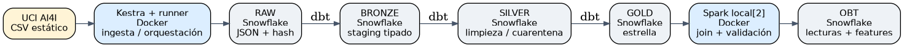
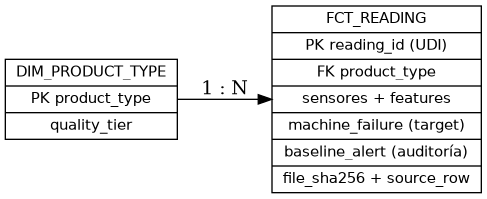

# 1. Arquitectura y alcance corregido

El proyecto prepara datos para **detectar el estado de falla en la lectura actual** y priorizar una revisión técnica. Corrige el PSet 1: AI4I no contiene fechas, historial por activo ni etiquetas del siguiente ciclo. No demuestra predicción futura, anticipación ni vida útil restante (RUL). La unidad es una observación sintética; `Product ID` no identifica una trayectoria temporal por máquina.

{width=100%}

El destino previsto es la base `PSET2` en Snowflake, con esquemas Raw, Bronze, Silver, Gold y OBT. Kestra ejecuta el contenedor de ingesta y dbt. Solo después de un `dbt build` satisfactorio Spark une Gold, valida cardinalidad y escribe `OBT_READINGS`. Compose define Kestra, su Postgres de metadatos, el runner y un servicio Spark de ejecución puntual. Spark usa dos núcleos en modo local: 10.000 filas no requieren un clúster distribuido.

Raw conserva strings originales en JSON, hash SHA-256 del CSV, fila fuente, URL y fecha de carga. Bronze tipa, Silver aplica contratos y separa cuarentena; Gold contiene el hecho de lecturas y una dimensión de tipo de producto. Spark construye la tabla ancha con features, target y trazabilidad. La fecha de carga es técnica, nunca una fecha de observación inventada.

**Evidencia y alcance.** Se ejecutaron las transformaciones con dbt/DuckDB y la OBT con Spark sobre una copia pública de AI4I. No se ejecutó el pipeline completo en Snowflake. Kestra validó/importó el flow principal y ejecutó una prueba local dbt/Spark con retry real de dos intentos. Cada usuario debe configurar su cuenta y llave autorizada siguiendo el README. Los resultados locales no equivalen a objetos creados en la nube. `validation.md` registra resultados y límites de esta sesión.

La estructura toma como referencia xGerart/pset_2. Su ERP, ventas, capturas y conclusiones no se trasladan al proyecto. El código fue escrito para AI4I; las fuentes y commits consultados constan en `references.md`.

\newpage

# 2. Ingesta y recuperación

**Fuente y contrato.** AI4I 2020, UCI, DOI `10.24432/C5HS5C`: snapshot de 10.000 observaciones sintéticas con 14 columnas. No hay frecuencia observada de sensores. La ingesta descarga por HTTPS desde UCI. En esta sesión el proxy devolvió 403; se validó localmente una copia pública de GitHub identificada por commit en las referencias. Falta comprobar su identidad con UCI.

El extractor exige columnas y orden exactos, un archivo no vacío y un único `ai4i2020.csv` dentro del ZIP. Un cambio de contrato detiene la carga. El SHA-256 del CSV local perfilado es:

`59db4f1d9c34c58136d89e5a006ec190dcea19e9dbea74f6b3b0c6f22a44d183`.

**Carga Raw.** El conector Snowflake autentica con llave privada externa a Git. Llena una tabla temporal y reconcilia su conteo con la extracción. Después del DDL inicia una transacción: elimina las filas del mismo hash e inserta el snapshot verificado. Si falla, hace rollback. La clave lógica es `(file_sha256, source_row)`; repetir un archivo no debe aumentar filas. Otros hashes se retienen. Bronze selecciona el hash cargado más recientemente y no mezcla versiones.

**Trigger.** `pset2.ai4i_pipeline` se programa lunes a las 06:00, America/Guayaquil. Es un chequeo del snapshot estático, no una periodicidad atribuida a los sensores. Concurrencia máxima uno y cola impiden carreras entre ejecuciones del flow. Ingesta, dbt y Spark son comandos secuenciales con parada ante error. No ejecutar cargas manuales simultáneas.

**Retries.** La descarga tiene timeouts y hasta tres reintentos de transporte ante 429/5xx. Kestra permite tres intentos de la tarea, con espera exponencial desde 10 s, máximo 2 min y timeout de 30 min. La idempotencia permite repetir la tarea completa. Los errores de contrato/calidad requieren corregir la causa; no se ignoran tests fallidos. Un log ERROR identifica la ejecución afectada.

**Backfill.** La primera ejecución carga toda la historia disponible: un snapshot sin fechas. Para replay se monta un CSV archivado y se entrega `historical_snapshot=/app/artifacts/ai4i_historico.csv` al flow. Esto promueve deliberadamente esa versión a actual. No se fabrican intervalos diarios. Verificar replay del mismo hash con conteos estables y documentar un retry controlado son comprobaciones cloud pendientes.

**Seguridad y recuperación.** `.env` y `secrets/` están ignorados; se publica solo la plantilla. Las llaves se montan en modo lectura y el administrador registra la pública en el usuario de servicio. Puertos locales limitados a loopback; no borrar volúmenes con `down -v`. Un fallo posterior a dbt puede dejar Gold nuevo y OBT anterior: no consumir la ejecución como actualización exitosa. La publicación atómica entre capas queda pendiente.

\newpage

# 3. Calidad: evidencia y decisiones

El perfil se calculó sobre las 10.000 filas de la copia identificada. `quality_results.json` conserva los resultados: no son mediciones de una planta.

| Problema / dimensión | Evidencia local | Acción y justificación |
|---|---|---|
| Completitud | 0 vacíos en cada una de 14 columnas | No imputar; nuevos faltantes críticos van a cuarentena. |
| Identidad | 0 filas extra con UDI repetido | Si aparece duplicidad, aislar todo el grupo: no hay tiempo de evento para elegir el más reciente. |
| Validez | 0 filas inválidas en el contrato | Tipo L/M/H, magnitudes positivas, desgaste no negativo y etiquetas binarias. |
| Consistencia | 27 discrepancias (0,27%): 18 sin falla general con algún subtipo; 9 con falla general sin subtipo | Conservar `Machine failure` y bandera de discrepancia; investigar, sin reconstruir el target. |
| Precisión | Aire 295,3–304,5 K; proceso 305,7–313,8 K; 1.168–2.886 rpm; torque 3,8–76,6 Nm; desgaste 0–253 min | Unidades/rangos plausibles; no prueban calibración ni exactitud frente a una verdad industrial. |
| Desbalance | 339 fallas (3,39%) | Preservar prevalencia; no sobremuestrear en ELT. |

**Limpieza dbt.** Bronze usa `source()` para leer Raw, renombra campos y convierte strings. Silver añade validez y conteo por UDI; conserva aceptadas y separa rechazadas en `int_quarantine`. No se borra ninguna observación de Raw. Un test exige cuarentena vacía para publicar; cualquier exclusión requiere revisar su causa. No se eliminan extremos solo por su magnitud: las colas pueden contener señales de falla.

Se comprueba diferencia positiva entre temperatura de proceso y aire, y potencia positiva, como contratos de esta fuente. No son reglas universales para cualquier fábrica. Las 27 discrepancias de etiquetas se conservan porque no hay fundamento para elegir automáticamente una verdad alternativa.

**Features.** Diferencia térmica = proceso − aire; potencia = torque × rpm × 2 × pi / 60. No se ajustan imputadores ni escaladores globales durante ELT. Esos pasos se aprenderían solo dentro del conjunto de entrenamiento para evitar fuga hacia validación.

**Pruebas.** dbt construyó seis modelos y aprobó 14 tests: unicidad/no nulidad, etiqueta binaria, relación hecho-dimensión, conservación Bronze = aceptadas + cuarentena, conservación del hecho, contrato físico y cuarentena vacía. Dos pruebas Python comprueban perfilado/rechazo de drift; dos pruebas Spark rechazan dimensión duplicada y join huérfano. Esta evidencia corresponde a DuckDB/Spark local. Falta validar la rama SQL Snowflake y la ejecución del flow principal contra esa cuenta.

\newpage

# 4. Modelo dimensional y OBT

{width=85%}

**Gold y grano.** `fct_reading` tiene una fila por UDI del snapshot activo: sensores, features, etiqueta, regla base y trazabilidad. `dim_product_type` tiene una fila por L/M/H y categoría de calidad. Es una estrella mínima: no se inventan dimensiones fecha, planta ni máquina. `product_id` se conserva como atributo degenerado para auditoría, no como identificador longitudinal o predictor.

Los modelos usan `ref()` para dependencias y `source()` para la fuente. Las capas tienen esquemas explícitos. `unique` y `not_null` validan grano; `relationships` exige que el tipo del hecho exista en la dimensión. Los tests de conservación impiden pérdidas silenciosas. DuckDB ejecuta los mismos modelos; únicamente el acceso a JSON usa sintaxis por adaptador.

**Job Spark.** Lee Gold con spark-snowflake 3.1.3/JDBC 3.24.2 y Spark 3.5.3/Scala 2.12. Valida claves únicas/no nulas antes de un left join por tipo. Después comprueba mismo número de filas, mismo número de IDs únicos y ausencia de huérfanos. Escribe `PSET2.OBT.OBT_READINGS` y vuelve a contar lo persistido. La llave privada permanece fuera de Git.

**Resultado local.** Gold se exportó a Parquet para ejecutar el mismo join: hecho 10.000 filas, OBT 10.000 filas, 10.000 IDs distintos y cero huérfanos. Se persistió y releyó Parquet. La escritura/relectura Snowflake todavía no fue ejecutada. Los tests negativos comprueban que un fanout o una clave huérfana impiden publicar.

**Contrato de entrenamiento futuro.** Predictoras autorizadas: tipo, temperaturas de aire/proceso, rpm, torque, desgaste, diferencia térmica y potencia. `machine_failure` es la etiqueta; UDI, hash y `baseline_alert` son auditoría. Los subtipos TWF/HDF/PWF/OSF/RNF no llegan a la OBT: explican la etiqueta y causarían fuga. Tampoco se usa `target_mode_disagreement` ni `product_id` al entrenar. La categoría de calidad deriva del tipo y no aporta señal independiente; no hace falta usar ambas.

**Uso de cada representación.** La estrella permite auditar y resumir por tipo con dimensión normalizada; la OBT ofrece columnas estables para ciencia de datos sin repetir joins. Su grano sigue siendo una lectura del snapshot activo, no una máquina por día. No se realiza entrenamiento en este PSet. La futura validación será estratificada, con ajuste/calibración dentro de entrenamiento; AI4I no admite un test temporal real.

\newpage

# 5. Costos, baseline y criterio de adopción

**Regla base:** alertar si desgaste **$\geq$ 200 min O torque $\geq$ 60 Nm**. Es una hipótesis auditable, pendiente de aprobación de un técnico, no una regla atribuida a expertos inexistentes ni una reconstrucción del generador de etiquetas. Produce TP=203, FP=817, FN=136, TN=8.844; recall **59,88%**, precisión **19,90%**, alertas **10,20%**. Son estadísticas descriptivas sobre el snapshot completo.

**Planta hipotética:** 100 evaluaciones independientes por turno y capacidad de 12 inspecciones. El CSV no acredita equipos ni turnos; no se extrapola anualmente. Supuestos por evento: inspección/acción planificada Cp=USD 500 (4 h técnicas × 50 + insumos/gestión 300); emergencia Ce=USD 8.000 (repuestos 3.000 + 8 h técnicas × 100 + 4 h de parada × margen 1.050); reparación residual tras detección Cr=USD 1.500. No incluyen inversión fija ni monetización de seguridad.

No son cotizaciones. Para estimarlos: clasificar órdenes CMMS planificadas/emergentes, unir facturas, horas y margen perdido con Finanzas; evitar doble conteo de producción/ventas; estimar medianas e intervalos con al menos 30 eventos por grupo si existen. Documentar moneda, fecha, activos y exclusiones. Sin muestra suficiente, conservar intervalos y no prometer ahorro.

Un FP cuesta USD 500 de inspección innecesaria; un FN deja USD 8.000 de contingencia; un TP cuesta Cp+Cr=USD 2.000. Cr<Ce supone que detectar la falla actual reduce daño secundario: es una hipótesis causal sin validar, no prevención demostrada. En la idea RUL descartada, sustituir 100 h antes con vida consumible a USD 20/h desperdiciaría USD 2.000; una sobrestimación que cause falla costaría USD 8.000 bajo este escenario. No se estima RUL con AI4I.

**Umbral futuro:** para probabilidad calibrada de falla actual, alertar si `p > Cp/(Ce−Cr) = 0,076923`, sujeto a capacidad. Se reemplaza así el 60–70% arbitrario. Si se exceden 12 alertas por 100 evaluaciones, priorizar riesgo y medir de nuevo costo/recall. Si Cr$\geq$ Ce, este modelo económico no justifica alertar.

Costo simulado = `(TP+FP)Cp + FN·Ce + TP·Cr`. Con conteos fijos sobre 10.000 lecturas:

| Escenario | Costo de regla (USD) | Ahorro vs. no alertar |
|---|---:|---:|
| Central | 1.902.500 | 29,85% |
| Emergencia 3.000 | 1.222.500 | −20,21% |
| Emergencia 15.000 | 2.854.500 | 43,86% |
| Inspección 1.000 | 2.412.500 | 11,04% |
| Inspección 250 | 1.647.500 | 39,25% |
| Sin beneficio residual: Cr=Ce | 3.222.000 | −18,81% |

Con capacidad del 5% y 8%, priorizando alertas por max(desgaste/200, torque/60), el recall cae a 39,82% y 54,57%; los costos son USD 2.084.500 y 1.909.500. Con 12% o 20% se atienden las mismas 1.020 alertas. No se usa el target para priorizar. Son escenarios ilustrativos, no ahorros observados ni umbrales optimizados. **Adopción futura:** exigir costo $\leq$ 90% de la regla, límite inferior IC bootstrap 95% del ahorro >0, recall $\geq$ 0,70, precisión $\geq$ 0,25 y alertas $\leq$ 12%. Elegir umbral en validación y verificar una vez en test reservado; repetir sensibilidad. Luego exigir datos reales y piloto prospectivo. PSet 2 no demuestra cumplimiento de estas metas.

\newpage

# 6. Batch, limitaciones y evidencia pendiente

**Batch.** Un snapshot estático sin eventos temporales permite cargas completas, idempotencia y replay sencillo. El chequeo semanal indica actualización de la fuente, no latencia industrial. El pipeline prepara análisis/entrenamiento y no necesita ingesta continua. La revisión por turno es un supuesto de negocio distinto de la frecuencia del archivo.

Streaming se justificaría con lecturas reales identificadas por activo/tiempo y una latencia máxima tal que esperar al lote tenga un costo material. Harían falta tiempos de evento y falla, ventanas, deduplicación, eventos tardíos, monitoreo de latencia y un servicio de inferencia con SLA. También habría que validar anticipación real. No se implementó streaming.

**Limitaciones materiales:**

1. AI4I es sintético y contiene falla actual. No permite demostrar reducción de paradas, RUL, riesgo futuro ni transferencia a una planta. Las 27 discrepancias requieren revisar la fuente.
2. Los resultados corresponden a una copia de GitHub con hash documentado. Falta compararla con UCI; la ingesta productiva mantiene UCI como fuente explícita.
3. Falta autenticar y ejecutar contra Snowflake. Kestra validó/importó el flow principal; una prueba local terminó SUCCESS tras un fallo controlado y retry. Compose y código preparados no equivalen a una ejecución end-to-end. Los detalles del build Docker constan en `validation.md`.
4. No hay publicación atómica entre Gold y OBT ni tabla dedicada de auditoría de ejecuciones. Una corrida fallida puede dejar generaciones diferentes hasta repetir correctamente; no debe consumirse como actualización.
5. La prueba Kestra valida lanzamiento Docker, dbt/Spark local y retry; no valida permisos Snowflake ni conectores cloud. Las dependencias directas y transitivas están fijadas en requirements.lock; fijar digests de imágenes queda como mejora de reproducción.
6. Los costos, capacidad y efectividad de la acción son supuestos. Si no se reduce daño secundario, inspeccionar aumenta el costo. El bootstrap i.i.d. sería exploratorio; datos reales requieren agrupación por activo/tiempo, estimar incertidumbre de costos y medir beneficio prospectivo.

**Evidencia entregada:** `quality_results.json`, `baseline_results.json`, `cost_sensitivity.csv`, scripts reproducibles, tests, diagramas DOT/PNG y memo Markdown/PDF. `validation.md` distingue lo comprobado localmente de lo pendiente. El baseline no cumple las metas propuestas de recall/precisión: mejorar accuracy no basta para implantar.

**Para completar la entrega cloud:** autorizar UCI y hostname Snowflake; registrar llave/usuario de servicio; construir imagen con confianza TLS válida; ejecutar el flow principal en Kestra; ejecutar snapshot completo, retry controlado y replay; comprobar conteos Raw/Bronze/Silver/Gold/OBT y conservar logs sin secretos. No se declara listo antes de terminar esas comprobaciones.

**Fuentes:** UCI AI4I 2020 (DOI 10.24432/C5HS5C); enunciado PSet 2 y memo PSet 1 proporcionados; xGerart/pset_2 como referencia estructural y BilalSikander/ai4i2020 para validación local. En `references.md` constan URLs y commits. No se reutilizaron capturas ni resultados del proyecto de ventas.
